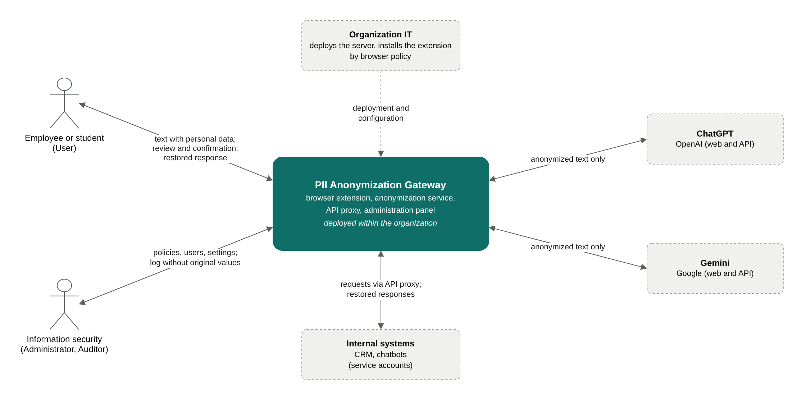
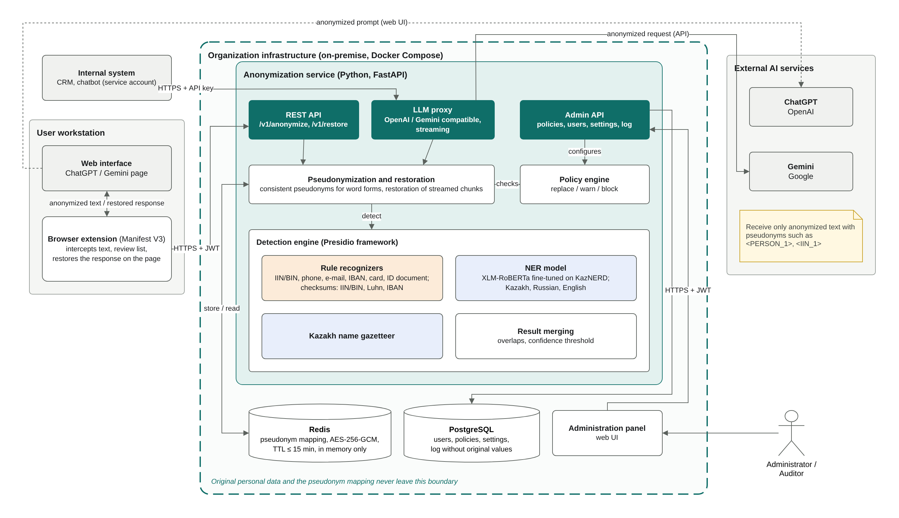
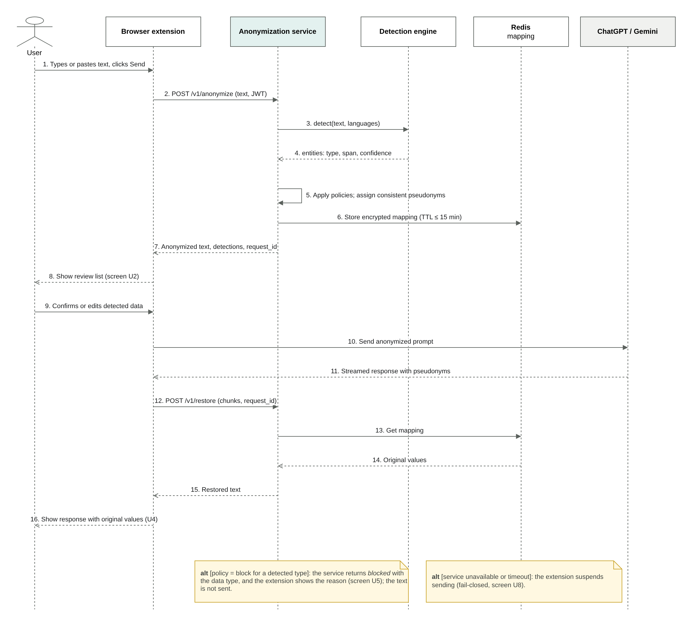
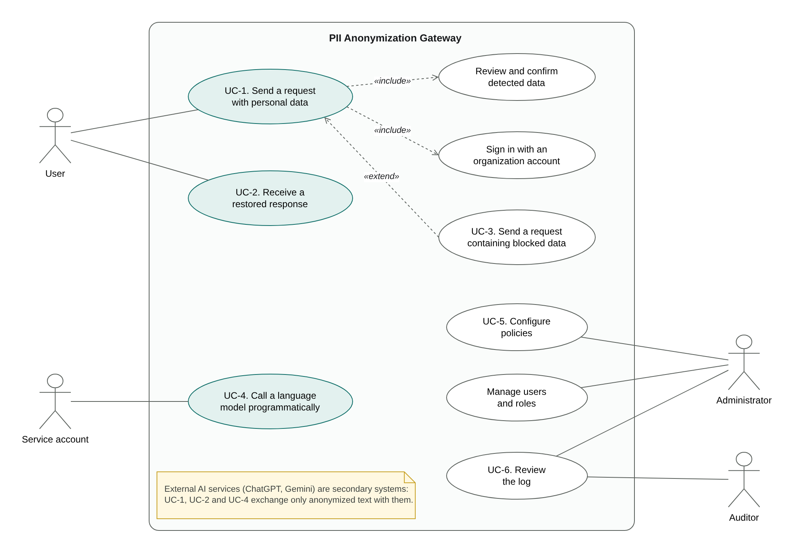
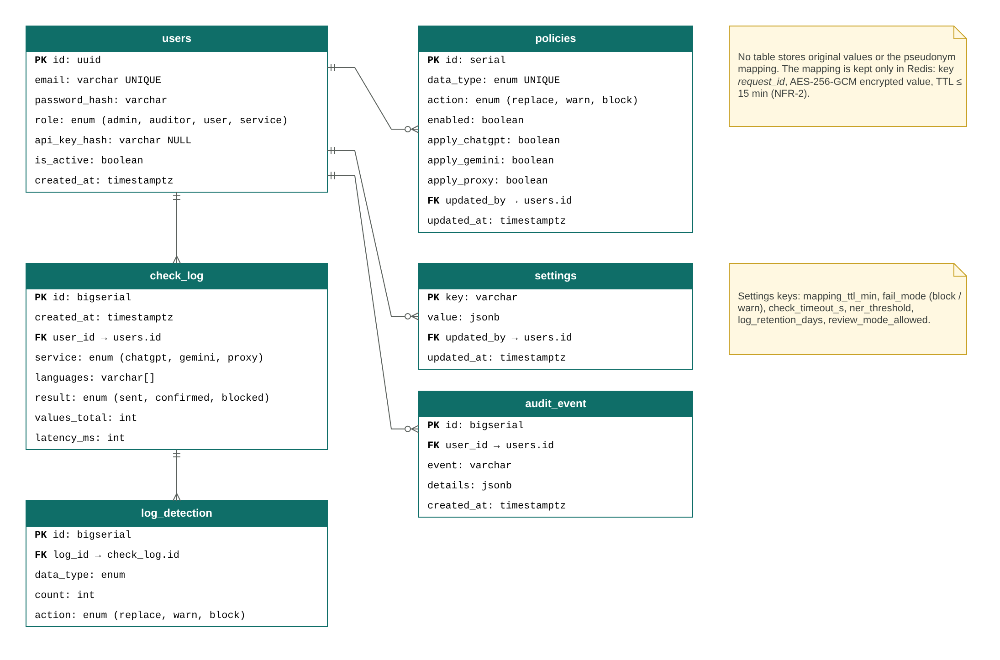

# System design diagrams

Editable sources (`.drawio`, open in [diagrams.net](https://app.diagrams.net)) and exported images (`.png`).
The full description is in [`docs/diagrams/diagrams.pdf`](../docs/diagrams/diagrams.pdf).

## System context

The system as a single element with its users and external systems. ChatGPT and Gemini receive only anonymized text.

## Component diagram (draft)

Components of the system and their deployment. Original personal data and the pseudonym mapping stay within the organization; only anonymized text is sent to AI services.

## Sequence of the main scenario

Sending a request with personal data through the browser extension and restoring the response (UC-1, UC-2).

## Use cases

Actors and use cases UC-1–UC-6 from the requirements specification.

## Database

PostgreSQL tables for users, policies, settings and the log. No table stores original values or the pseudonym mapping (kept only in Redis, encrypted, TTL ≤ 15 min).

